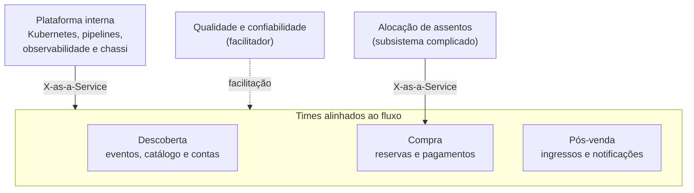

# Práticas e Tecnologias para Microsserviços

Guia de referência rápida sobre **o que torna uma arquitetura de microsserviços viável na prática**: organização dos times, ownership, Team Topologies, cultura DevOps, estratégia de testes, containers, orquestração, nuvem, padrões, *microservice chassis* e o ecossistema cloud native.

> [!NOTE]
> Síntese pessoal, escrita com minhas palavras, de conceitos consolidados na literatura de arquitetura e de engenharia de software. As fontes estão nas [referências](#referências). Complementa os guias [Fundamentos de Arquitetura de Software](https://github.com/sidartaoss/fundamentos-arquitetura-software) e [Monolitos e Microsserviços](https://github.com/sidartaoss/monolitos-e-microsservicos).

## Em resumo

- **Microsserviços são uma decisão sociotécnica.** A estrutura dos times, a cultura e a plataforma pesam tanto quanto o código.
- **Os times desenham a arquitetura.** Times pequenos, multifuncionais e alinhados a capacidades de negócio são condição para serviços autônomos.
- **Quem constrói opera.** Ownership de longo prazo e cultura DevOps eliminam a passagem de bastão entre desenvolvimento e operação.
- **Automação é pré-requisito.** Testes, pipelines, infraestrutura como código e observabilidade tornam viável evoluir e operar dezenas de serviços.
- **Tecnologias facilitam, mas não definem o estilo.** Containers, orquestração, nuvem, padrões e chassis resolvem problemas recorrentes, cada um com seu custo; nenhum deles é obrigatório.

## 1. Times: estrutura, tamanho e autonomia

> "As atribuições dos times são o primeiro rascunho da arquitetura." — Michael Nygard

- **Um serviço, um time dono.** No padrão *Service per Team*, de Chris Richardson, cada serviço pertence a um único time, que só deve manter mais de um serviço quando houver necessidade comprovada.
- **Manobra inversa de Conway.** Se a arquitetura tende a reproduzir a estrutura de comunicação da organização, os times podem ser desenhados de propósito para produzir a arquitetura desejada (Jonny LeRoy e Matt Simons, 2010).
- **Times pequenos.** O *two-pizza team* da Amazon, em geral com menos de dez pessoas, resume o princípio: pequeno para se comunicar bem e limitar a carga cognitiva; completo para construir e operar o serviço sem depender de outros times.
- **Autonomia com alinhamento.** Cada time escolhe a tecnologia adequada ao seu problema, dentro de diretrizes comuns; heterogeneidade sem critério multiplica os custos de contratação, treinamento e operação.

| Times por especialidade técnica | Times por capacidade de negócio |
|---|---|
| Uma mudança atravessa vários times, com filas e passagens de bastão | Um time entrega a mudança de ponta a ponta |
| As fronteiras do software seguem as camadas técnicas | As fronteiras do software seguem as capacidades de negócio |
| Tende ao monolito ou, com serviços, ao monolito distribuído | Favorece serviços coesos, implantados de forma independente |

## 2. Ownership: produtos, não projetos

> "Você constrói, você opera." — Werner Vogels, CTO da Amazon (2006)

| | Mentalidade de projeto | Mentalidade de produto |
|---|---|---|
| Horizonte | Começo, meio e fim | Contínuo, enquanto a capacidade de negócio existir |
| Time | Desmobilizado após a entrega; a sustentação fica com outro time | Estável e responsável pelo serviço durante todo o ciclo de vida |
| Conhecimento | Perde-se a cada passagem de bastão | Permanece com quem constrói e opera |
| Sucesso medido por | Prazo, escopo e orçamento | Resultado para o negócio e saúde do serviço em produção |

Quando sente em produção os efeitos das próprias decisões (alertas, incidentes, custo), o time passa a investir em observabilidade, testes e design para falhas.

## 3. Team Topologies

Matthew Skelton e Manuel Pais propõem quatro tipos fundamentais de time, orientados por um princípio: **limitar a carga cognitiva** de cada um.

| Tipo | Missão | Cuidado |
|---|---|---|
| **Alinhado ao fluxo** (*stream-aligned*) | Entregar valor continuamente em uma fatia do domínio, com todas as competências para desenvolver, implantar e operar | É o tipo principal; os demais existem para apoiá-lo |
| **Plataforma** (*platform*) | Oferecer, como produto interno e em autosserviço, infraestrutura, pipelines e observabilidade | Facilitar sem impor nem virar gargalo |
| **Facilitador** (*enabling*) | Ajudar outros times a adotar práticas e tecnologias, por tempo limitado | Buscar a autonomia do time apoiado, não a dependência |
| **Subsistema complicado** (*complicated-subsystem*) | Cuidar de componentes que exigem conhecimento altamente especializado | Apenas quando necessário; o excesso fragmenta o fluxo |

Os times interagem por **colaboração** (trabalho conjunto, por um período definido), ***X-as-a-Service*** (um time consome o que outro oferece, com o mínimo de coordenação) ou **facilitação** (um time orienta outro).

## 4. Cultura DevOps

DevOps é, antes de tudo, uma cultura, e não uma ferramenta nem um cargo: desenvolvimento e operação passam a compartilhar objetivos, práticas e a responsabilidade pelo software em produção. Em um monolito, a separação entre as duas áreas é custosa; com dezenas de serviços, cada um com stack e ciclo de deploy próprios, torna-se inviável.

| Prática | O que viabiliza | Exemplos de ferramentas |
|---|---|---|
| Infraestrutura como código (IaC) | Ambientes reproduzíveis e versionados | Terraform, OpenTofu, Pulumi, Crossplane |
| Integração contínua (CI) | Build e testes automáticos a cada mudança | GitHub Actions, GitLab CI, Jenkins |
| Entrega e implantação contínuas (CD) | Versões sempre implantáveis, com deploy automatizado | Argo CD, Flux |
| Configuração e segredos | Configuração fora do artefato e credenciais fora do código | HashiCorp Vault, Kubernetes Secrets |
| Escala automática | Capacidade ajustada à demanda de cada serviço | Kubernetes HPA, KEDA |
| Observabilidade | Logs centralizados, métricas e tracing distribuído | OpenTelemetry, Prometheus, Grafana, Jaeger |

- **DevOps não é um time à parte.** Um "time de DevOps" permanente entre desenvolvimento e operação recria o silo que a cultura pretende eliminar; o catálogo *DevOps Topologies*, de Skelton e Pais, o classifica como antipadrão. SRE (*Site Reliability Engineering*, disciplina criada no Google) e engenharia de plataforma apoiam a responsabilidade dos times, sem substituí-la.
- **Medir para melhorar.** As métricas DORA, como frequência de deploy, lead time e taxa de falha de mudanças, indicam se as práticas funcionam.

## 5. Estratégia de testes

Em microsserviços, boa parte do risco está nas fronteiras: contratos entre serviços, mensagens assíncronas e dependências de infraestrutura. A estratégia de testes precisa validar essas fronteiras sem exigir que o sistema inteiro esteja no ar.

| Nível | O que valida | Custo e velocidade | Ferramentas comuns |
|---|---|---|---|
| Unitário | Regras de negócio e classes isoladas, sem I/O | Milissegundos; a base da pirâmide | JUnit, Mockito |
| Integração | Adaptadores com dependências reais: banco, broker, clientes HTTP | Segundos, com containers descartáveis | Testcontainers, WireMock |
| Componente | O serviço inteiro, isolado, com as dependências simuladas | Segundos | Spring Boot Test, REST Assured |
| Contrato | Compatibilidade entre consumidor e provedor de uma API ou mensagem | Rápido, no pipeline de cada lado | Pact, Spring Cloud Contract |
| Ponta a ponta | Jornadas críticas que atravessam vários serviços | Lento, caro e frágil | Playwright, REST Assured |
| Carga (fora da pirâmide) | Tempo de resposta, vazão e gargalos | Exige ambiente representativo | Grafana k6, Gatling, JMeter |

- **Pirâmide, não sorvete.** Muitos testes rápidos na base e poucos testes ponta a ponta, restritos às jornadas críticas; a inversão produz suítes lentas e instáveis.
- **Contratos orientados ao consumidor.** Cada consumidor publica o que espera do provedor, que verifica esses contratos no próprio pipeline e detecta uma quebra antes do deploy (Ian Robinson, 2006).

## 6. Containers, orquestração e nuvem

- **Containers.** O padrão *Service instance per container* empacota cada serviço com suas dependências e executa cada instância isoladamente. Por compartilhar o kernel do host, em vez de executar um sistema operacional completo como uma VM, o container é leve, inicia rápido e se comporta da mesma forma em qualquer ambiente.
- **Orquestração.** O **Kubernetes** recebe o estado desejado de forma declarativa e o mantém: distribui as instâncias, reinicia as que falham, escala conforme a demanda, balanceia a carga e faz atualizações graduais, com rollback.
- **Nuvem.** Pela definição do NIST, reúne autosserviço sob demanda, amplo acesso pela rede, compartilhamento de recursos, elasticidade rápida e serviço medido: capacidade em minutos, pagamento pelo uso e serviços gerenciados ou serverless.

| Opção de execução | Quando faz sentido | Trade-off |
|---|---|---|
| Servidores físicos ou VMs | Poucos serviços, tráfego previsível, restrições regulatórias | Provisionamento e escala pouco automatizados |
| Containers sem orquestrador | Poucos serviços, em ambientes simples | Recuperação de falhas e escala a cargo do time |
| Kubernetes gerenciado | Muitos serviços, demanda variável, time de plataforma | Curva de aprendizado e custo operacional |
| Serverless | Cargas intermitentes ou orientadas a eventos | Limites de execução, *cold start* e dependência do provedor |

## 7. Padrões e microservice chassis

**Padrões.** Na tradição de Christopher Alexander, cada padrão descreve **contexto, problema, forças, solução, consequências e padrões relacionados**; as consequências de um padrão costumam abrir os problemas que o próximo resolve. Os nomes variam entre autores: o *Strangler Fig* de Martin Fowler é o *Strangler Application* de Chris Richardson.

| Foco | Catálogo | Autores |
|---|---|---|
| Microsserviços: decomposição, dados, comunicação, implantação | [microservices.io](https://microservices.io/patterns/) | Chris Richardson |
| Estabilidade: *timeouts*, *circuit breaker*, *bulkheads* | *Release It!* | Michael Nygard |
| Integração e mensageria | [*Enterprise Integration Patterns*](https://www.enterpriseintegrationpatterns.com/) | Gregor Hohpe e Bobby Woolf |
| Eventos e streams | [*Event Streaming Patterns*](https://developer.confluent.io/patterns/) | Confluent |
| Nuvem | [*Cloud Design Patterns*](https://learn.microsoft.com/azure/architecture/patterns/); [*Cloud design patterns*](https://docs.aws.amazon.com/prescriptive-guidance/latest/cloud-design-patterns/introduction.html) | Microsoft; AWS |
| Internos de sistemas distribuídos: replicação, consenso | [*Patterns of Distributed Systems*](https://martinfowler.com/articles/patterns-of-distributed-systems/) | Unmesh Joshi |

**Chassis.** Todo serviço precisa resolver as mesmas preocupações transversais (*cross-cutting concerns*), alheias à lógica de negócio. O padrão *Microservice chassis* as concentra, com a lógica de build, em uma base reutilizável; no ecossistema Java, Spring Boot e Spring Cloud cumprem esse papel. Parte dessas preocupações pode, ainda, sair do código e ir para a plataforma.

| Preocupação transversal | No chassi (Spring) | Na plataforma |
|---|---|---|
| Configuração e segredos | Spring Cloud Config, Spring Cloud Vault | ConfigMaps e Secrets do Kubernetes |
| Descoberta de serviços | Spring Cloud Netflix (Eureka) | Services e DNS do Kubernetes |
| Clientes HTTP | HTTP Service Clients (`@HttpExchange`); o OpenFeign está em modo *feature-complete* | — |
| Resiliência | Spring Cloud Circuit Breaker, com Resilience4j | *Service mesh* (Istio, Linkerd) |
| Observabilidade | Spring Boot Actuator e Micrometer | OpenTelemetry Collector, Prometheus |
| Segurança | Spring Security | mTLS no *service mesh* |

| O chassi ganha | E abre mão de |
|---|---|
| Menos código repetitivo e foco na lógica de negócio | Flexibilidade tecnológica: um chassi por linguagem |
| Consistência entre serviços | Independência: cada atualização do chassi exige rebuild e redeploy dos serviços |
| Manutenção centralizada das dependências | Simplicidade, se o chassi crescer além do necessário |

## 8. Ecossistema cloud native

Pela definição da CNCF (*Cloud Native Computing Foundation*, parte da Linux Foundation), práticas cloud native permitem construir e implantar cargas de trabalho em nuvens públicas, privadas ou híbridas de forma programática e repetível, com sistemas fracamente acoplados, resilientes e observáveis. Seus projetos são classificados em **sandbox** (experimental), **incubação** (em produção em poucas organizações), **graduado** (estável e amplamente adotado) e **arquivado**.

| Preocupação | Projetos graduados (exemplos) |
|---|---|
| Orquestração e runtime | Kubernetes, containerd, CRI-O |
| Empacotamento e entrega contínua | Helm, Argo, Flux, Buildpacks |
| Observabilidade | OpenTelemetry, Prometheus, Jaeger, Fluentd |
| Rede e *service mesh* | Envoy, Istio, Linkerd, Cilium |
| Escala e eventos | KEDA, Knative, Dapr, CloudEvents |
| Segurança e políticas | Open Policy Agent, Kyverno, Falco, cert-manager |

Situação em outubro de 2026, conforme [cncf.io/projects](https://www.cncf.io/projects/). Maturidade não substitui a avaliação de adequação ao contexto.

## 9. Exemplo aplicado: plataforma de venda de ingressos

A plataforma dos guias anteriores combina um monolito modular (eventos, catálogo e contas) a serviços de reservas, pagamentos e notificações ([detalhes](https://github.com/sidartaoss/monolitos-e-microsservicos#7-exemplo-aplicado-plataforma-de-venda-de-ingressos)). Organizada segundo Team Topologies:

O time de compra mantém dois serviços porque reservas e pagamentos formam um único fluxo de valor, mas têm perfis distintos de escala e de falha. A alocação de assentos, que escolhe os melhores lugares contíguos disponíveis sob alta concorrência, exige conhecimento especializado e é oferecida como biblioteca ao time de compra. O time facilitador apoia, por tempo limitado, a adoção de testes de contrato e de carga.

A abertura das vendas, que concentra em minutos o tráfego de semanas, orienta as práticas:

| Prática | Aplicação | Trade-off |
|---|---|---|
| Testes de contrato | Pagamentos verifica, no próprio pipeline, os contratos de reservas (HTTP) e de notificações (eventos) | Contratos também exigem manutenção |
| Testes de carga | Simulação da abertura antes de cada grande evento: p95 abaixo de 300 ms a 2 mil compras por segundo | Um ambiente representativo custa caro |
| Escala automática | Reservas escala pela profundidade da fila de pedidos (KEDA), e não só por CPU | Exige limites de custo e testes da própria escala |
| Chassi interno | Observabilidade, segurança e resiliência padronizadas nos serviços Java | Serviços em outra linguagem exigem outra solução |
| Observabilidade | Tracing distribuído do funil de compra, da reserva ao pagamento | Custo de coleta e de armazenamento |

Escolhas como Kubernetes gerenciado em vez de VMs, ou chassi interno em vez de *service mesh*, são decisões arquiteturais com trade-offs explícitos e, por isso, devem ser registradas em um ADR.

## Referências

- Matthew Skelton e Manuel Pais — *Team Topologies* (IT Revolution, 2019), [Key Concepts](https://teamtopologies.com/key-concepts) e [DevOps Topologies](https://web.devopstopologies.com/)
- James Lewis e Martin Fowler — [Microservices](https://martinfowler.com/articles/microservices.html) (2014)
- Martin Fowler — [Conway's Law](https://martinfowler.com/bliki/ConwaysLaw.html) (2022) e [Microservice Prerequisites](https://martinfowler.com/bliki/MicroservicePrerequisites.html) (2014)
- Chris Richardson — *Microservices Patterns* (Manning, 2018) e [microservices.io](https://microservices.io/patterns/)
- Werner Vogels — [A Conversation with Werner Vogels](https://queue.acm.org/detail.cfm?id=1142065) (*ACM Queue*, 2006)
- Gene Kim, Jez Humble, Patrick Debois e John Willis — *The DevOps Handbook*, 2ª ed. (IT Revolution, 2021)
- Nicole Forsgren, Jez Humble e Gene Kim — *Accelerate* (IT Revolution, 2018) e [métricas DORA](https://dora.dev/guides/dora-metrics/)
- Ham Vocke — [The Practical Test Pyramid](https://martinfowler.com/articles/practical-test-pyramid.html) (2018); Ian Robinson — [Consumer-Driven Contracts](https://martinfowler.com/articles/consumerDrivenContracts.html) (2006)
- NIST — [SP 800-145: The NIST Definition of Cloud Computing](https://csrc.nist.gov/pubs/sp/800/145/final) (2011)
- Michael T. Nygard — *Release It!*, 2ª ed. (Pragmatic Bookshelf, 2018)
- CNCF — [Cloud Native Definition](https://github.com/cncf/toc/blob/main/DEFINITION.md) e [projetos](https://www.cncf.io/projects/)
